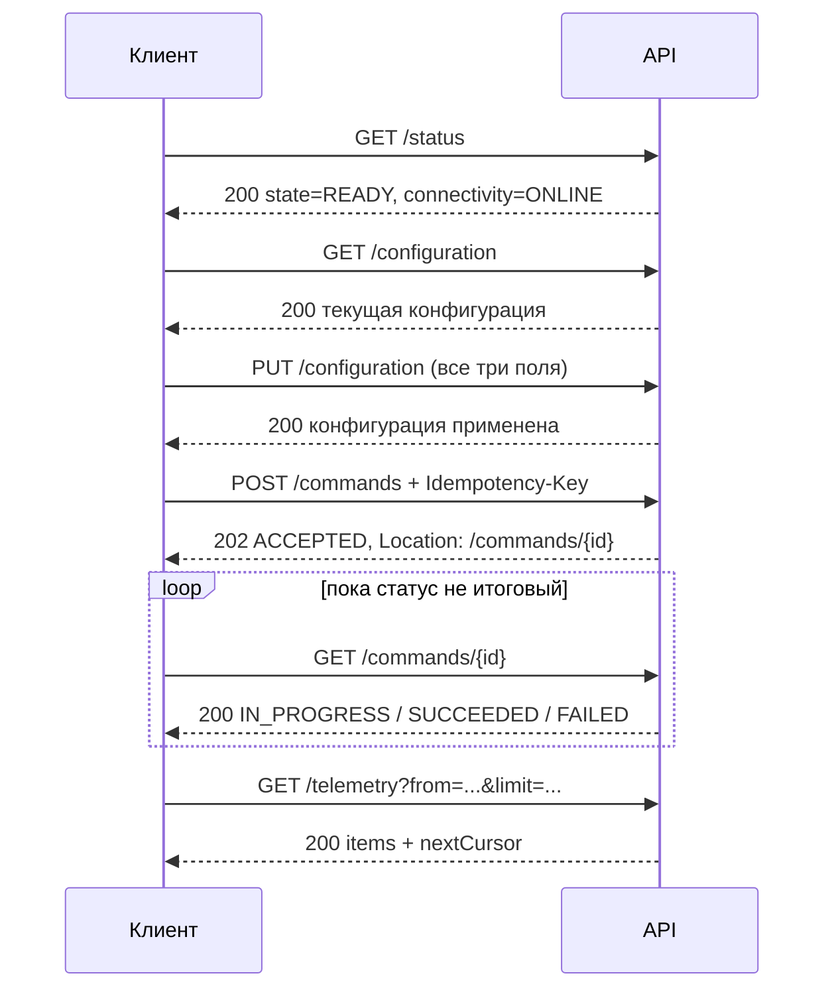

# Signal Generator Management API

Демонстрационный REST API для управления генератором сигналов: позволяет получить сведения
об устройстве и его состоянии, прочитать и заменить конфигурацию, отправить команду и отследить
её выполнение, прочитать записанную телеметрию.

> Контракт демонстрационный и не управляет физическим оборудованием. Адрес `https://api.example.com`
> — пример: реальной точки доступа по нему нет.

| | |
|---|---|
| Спецификация | [`openapi.yaml`](openapi.yaml) — OpenAPI 3.1.0, версия документа 2.1.0 |
| Версия API в пути | `/v1` |
| Формат данных | JSON (`application/json`), время — RFC 3339 / ISO 8601 в UTC (`2026-01-15T10:20:30Z`) |
| Аутентификация | `Authorization: Bearer <токен>` |

## Документация

| Раздел | О чём |
|---|---|
| [Быстрый старт](#быстрый-старт) | Первый запрос и типичный сценарий за 5 минут |
| [Справочник эндпоинтов](docs/endpoints.md) | Все 7 операций: параметры, тела, ответы, примеры |
| [Диаграммы](docs/diagrams.md) | Контекст, модель ресурсов, жизненный цикл команды, ключевые сценарии и правила |
| **Руководства** | |
| [Аутентификация](docs/guides/authentication.md) | Токен, ответы 401 и 403 |
| [Ошибки](docs/guides/errors.md) | Формат ошибки, коды, 400 или 422, `correlationId` |
| [Команды и идемпотентность](docs/guides/commands-and-idempotency.md) | Асинхронные команды, опрос статуса, `Idempotency-Key` |
| [Телеметрия и постраничная выдача](docs/guides/telemetry-pagination.md) | Временное окно, `limit`, курсор |
| [Лимиты и повторные попытки](docs/guides/rate-limits-and-retries.md) | 429, 503, `Retry-After`, что и когда безопасно повторять |
| [Версии и совместимость](docs/guides/versioning.md) | Что считается совместимым изменением, как писать устойчивого клиента |
| [Работа с Postman-коллекцией](docs/postman.md) | Импорт, окружения, мок-сервер, тесты, частые проблемы |

## Файлы в папке

| Файл | Назначение |
|---|---|
| `openapi.yaml` | Контракт API — источник истины. При расхождении с этой документацией прав контракт |
| `signal-generator-api.postman_collection.json` | Postman-коллекция: рабочие запросы, сценарии и проверка всех кодов ответа |
| `signal-generator.postman_environment.json` | Окружение Postman с переменными (`baseUrl`, `accessToken`, `useMock` и др.) |
| `SRS_Signal_Generator_API.docx` | Спецификация требований (SRS) по ISO/IEC/IEEE 29148 — черновик для согласования |
| `docs/` | Эта документация |

### Типичный сценарий

### Дополнительная информация

- В каждом ответе есть заголовок **`X-Correlation-Id`**. Сохраняйте его в логах и прикладывайте
  к обращениям в поддержку — по нему находят запрос в журналах сервиса.
- Логику обработки ошибок стройте по полю **`code`** в теле, а не по тексту `message`.
- Будьте готовы к **новым полям и новым значениям** перечислений в ответах — это не считается
  несовместимым изменением ([Версии и совместимость](docs/guides/versioning.md)).
