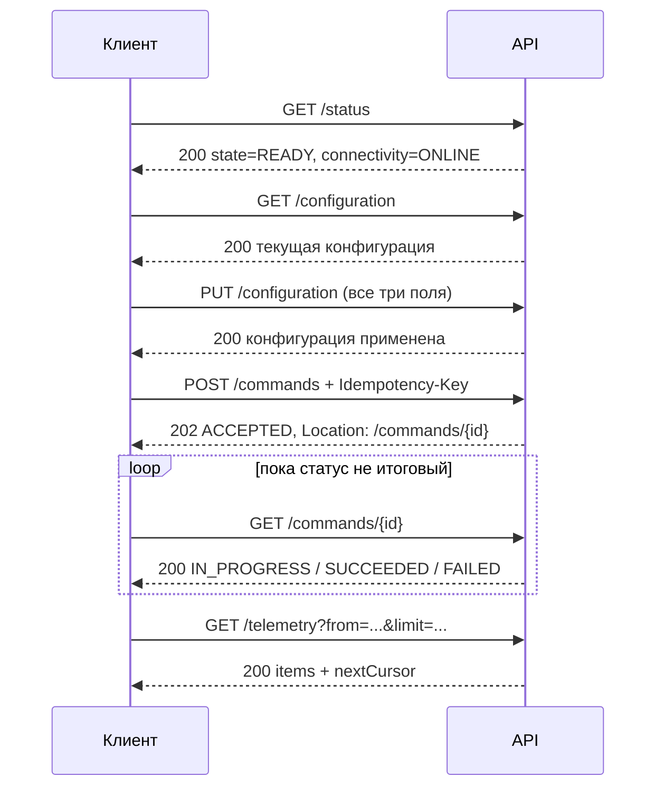

# Signal Generator Management API

Демонстрационный REST API для управления генератором сигналов: позволяет получить сведения
об устройстве и его состоянии, прочитать и заменить конфигурацию, отправить команду и отследить
её выполнение, прочитать записанную телеметрию.

> Контракт демонстрационный и не управляет физическим оборудованием. Адрес `https://api.example.com`
> — пример: реальной точки доступа по нему нет.

| | |
|---|---|
| Спецификация | [`openapi.yaml`](openapi.yaml) — OpenAPI 3.1.0, версия документа 2.1.0 |
| Версия API в пути | `/v1` |
| Формат данных | JSON (`application/json`), время — RFC 3339 / ISO 8601 в UTC (`2026-01-15T10:20:30Z`) |
| Аутентификация | `Authorization: Bearer <токен>` |

## Документация

| Раздел | О чём |
|---|---|
| [Быстрый старт](#быстрый-старт) | Первый запрос и типичный сценарий за 5 минут |
| [Справочник эндпоинтов](docs/endpoints.md) | Все 7 операций: параметры, тела, ответы, примеры |
| [Диаграммы](docs/diagrams.md) | Контекст, модель ресурсов, жизненный цикл команды, ключевые сценарии и правила |
| **Руководства** | |
| [Аутентификация](docs/guides/authentication.md) | Токен, ответы 401 и 403 |
| [Ошибки](docs/guides/errors.md) | Формат ошибки, коды, 400 или 422, `correlationId` |
| [Команды и идемпотентность](docs/guides/commands-and-idempotency.md) | Асинхронные команды, опрос статуса, `Idempotency-Key` |
| [Телеметрия и постраничная выдача](docs/guides/telemetry-pagination.md) | Временное окно, `limit`, курсор |
| [Лимиты и повторные попытки](docs/guides/rate-limits-and-retries.md) | 429, 503, `Retry-After`, что и когда безопасно повторять |
| [Версии и совместимость](docs/guides/versioning.md) | Что считается совместимым изменением, как писать устойчивого клиента |
| [Работа с Postman-коллекцией](docs/postman.md) | Импорт, окружения, мок-сервер, тесты, частые проблемы |

## Файлы в папке

| Файл | Назначение |
|---|---|
| `openapi.yaml` | Контракт API — источник истины. При расхождении с этой документацией прав контракт |
| `signal-generator-api.postman_collection.json` | Postman-коллекция: рабочие запросы, сценарии и проверка всех кодов ответа |
| `signal-generator.postman_environment.json` | Окружение Postman с переменными (`baseUrl`, `accessToken`, `useMock` и др.) |
| `SRS_Signal_Generator_API.docx` | Спецификация требований (SRS) по ISO/IEC/IEEE 29148 — черновик для согласования |
| `docs/` | Эта документация |

## Быстрый старт

### 1. Подготовьте адрес и токен

```bash
export BASE_URL="https://api.example.com"   # адрес API или мок-сервера
export TOKEN="<ваш токен доступа>"          # выдаётся владельцем API
```

> Примеры написаны для bash (Linux, macOS, Git Bash в Windows). В PowerShell используйте
> `$env:TOKEN = "..."` и `curl.exe` вместо `curl`.

### 2. Первый запрос — сведения об устройстве

```bash
curl -i "$BASE_URL/v1/devices/sg-001" \
  -H "Authorization: Bearer $TOKEN"
```

```http
HTTP/1.1 200 OK
Content-Type: application/json
X-Correlation-Id: 7f3c2b1e-0000-4000-8000-000000000010

{
  "id": "sg-001",
  "name": "Signal Generator 001",
  "model": "SG-Demo",
  "firmwareVersion": "1.2.0",
  "connectivity": "ONLINE"
}
```

Получили `401`? Проверьте токен — см. [Аутентификация](docs/guides/authentication.md).

### 3. Типичный сценарий



**a. Убедитесь, что устройство на связи и готово**

```bash
curl "$BASE_URL/v1/devices/sg-001/status" -H "Authorization: Bearer $TOKEN"
```

Нужно `connectivity: "ONLINE"`. Если устройство не может выполнить команду в текущем состоянии,
API вернёт `409 DEVICE_NOT_READY`.

**b. Прочитайте и замените конфигурацию.** `PUT` заменяет конфигурацию целиком, поэтому сначала
получите текущую, измените нужное поле и отправьте все три.

```bash
curl "$BASE_URL/v1/devices/sg-001/configuration" -H "Authorization: Bearer $TOKEN"

curl -X PUT "$BASE_URL/v1/devices/sg-001/configuration" \
  -H "Authorization: Bearer $TOKEN" \
  -H "Content-Type: application/json" \
  -d '{"profile": "STANDARD", "outputLevel": 20, "telemetryIntervalSeconds": 5}'
```

Ответ `200` означает, что конфигурация **уже применена устройством**.

**c. Отправьте команду с ключом идемпотентности**

```bash
curl -i -X POST "$BASE_URL/v1/devices/sg-001/commands" \
  -H "Authorization: Bearer $TOKEN" \
  -H "Content-Type: application/json" \
  -H "Idempotency-Key: $(uuidgen)" \
  -d '{"command": "START", "parameters": {}}'
```

Ответ `202 Accepted` значит «принято», а не «выполнено». Сохраните ключ: при сбое сети повторите
запрос **с тем же ключом** — дубль команды не создастся.

**d. Дождитесь результата** по ссылке из заголовка `Location`:

```bash
curl "$BASE_URL/v1/devices/sg-001/commands/cmd-10001" -H "Authorization: Bearer $TOKEN"
```

Повторяйте с паузой, пока `status` не станет `SUCCEEDED` или `FAILED`.
Подробнее — [Команды и идемпотентность](docs/guides/commands-and-idempotency.md).

**e. Прочитайте телеметрию**

```bash
curl "$BASE_URL/v1/devices/sg-001/telemetry?from=2026-01-15T10:00:00Z&to=2026-01-15T11:00:00Z&limit=100" \
  -H "Authorization: Bearer $TOKEN"
```

Если в ответе `nextCursor` не `null`, есть следующая страница —
см. [Телеметрия и постраничная выдача](docs/guides/telemetry-pagination.md).

### 4. Что ещё стоит знать сразу

- В каждом ответе есть заголовок **`X-Correlation-Id`**. Сохраняйте его в логах и прикладывайте
  к обращениям в поддержку — по нему находят запрос в журналах сервиса.
- Логику обработки ошибок стройте по полю **`code`** в теле, а не по тексту `message`.
- Будьте готовы к **новым полям и новым значениям** перечислений в ответах — это не считается
  несовместимым изменением ([Версии и совместимость](docs/guides/versioning.md)).

## Поддержка

Поддержка API: api-support@example.com. В обращении укажите `X-Correlation-Id` проблемного ответа.
