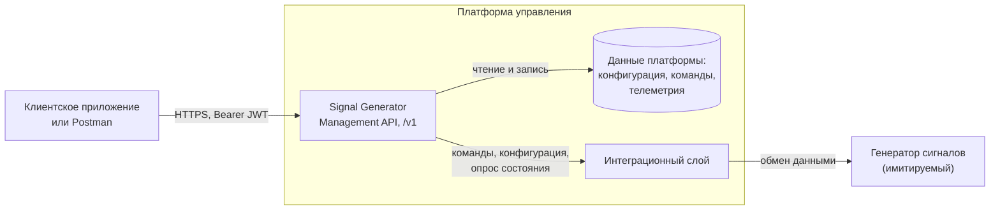
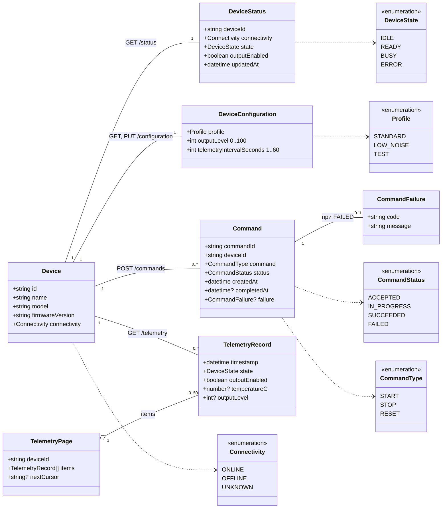
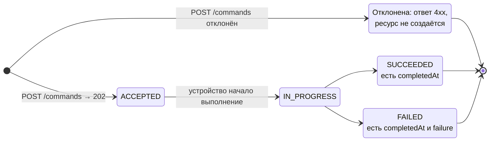
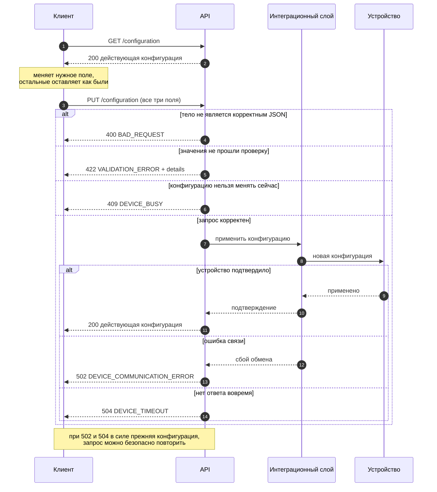
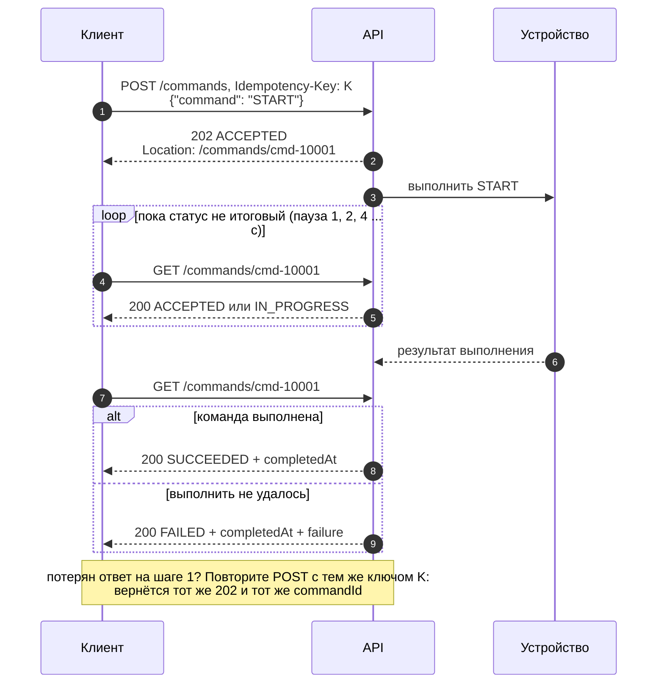
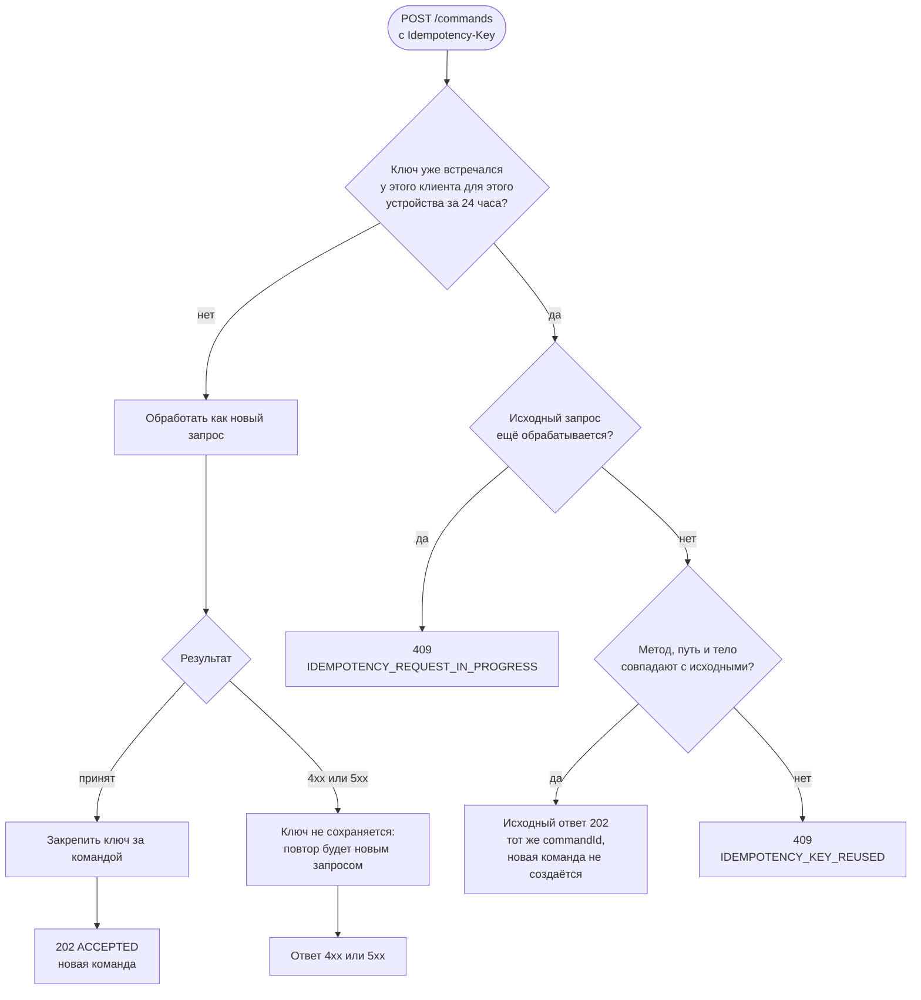
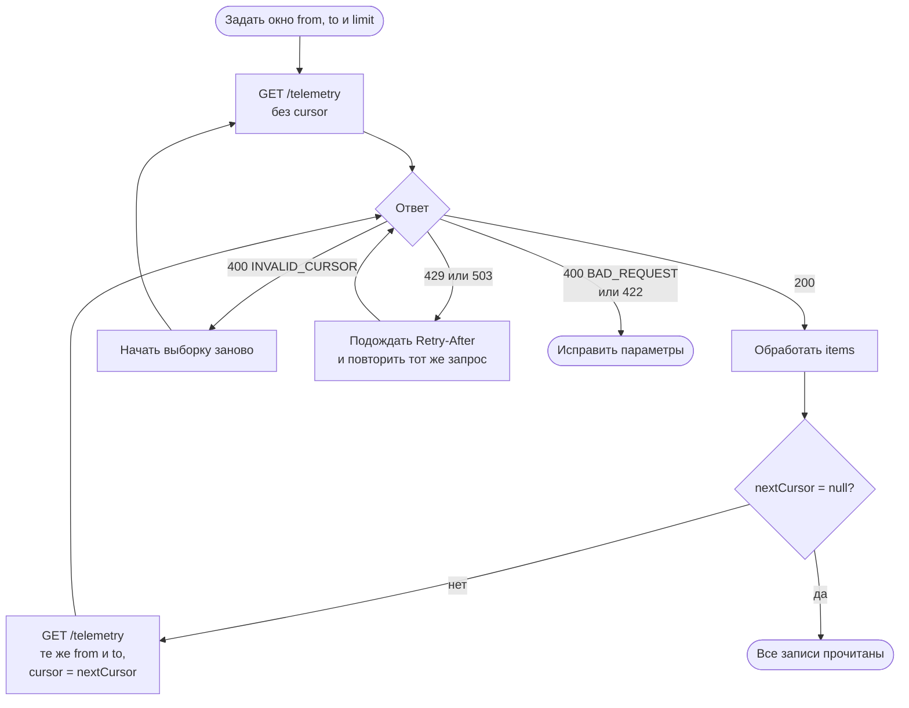
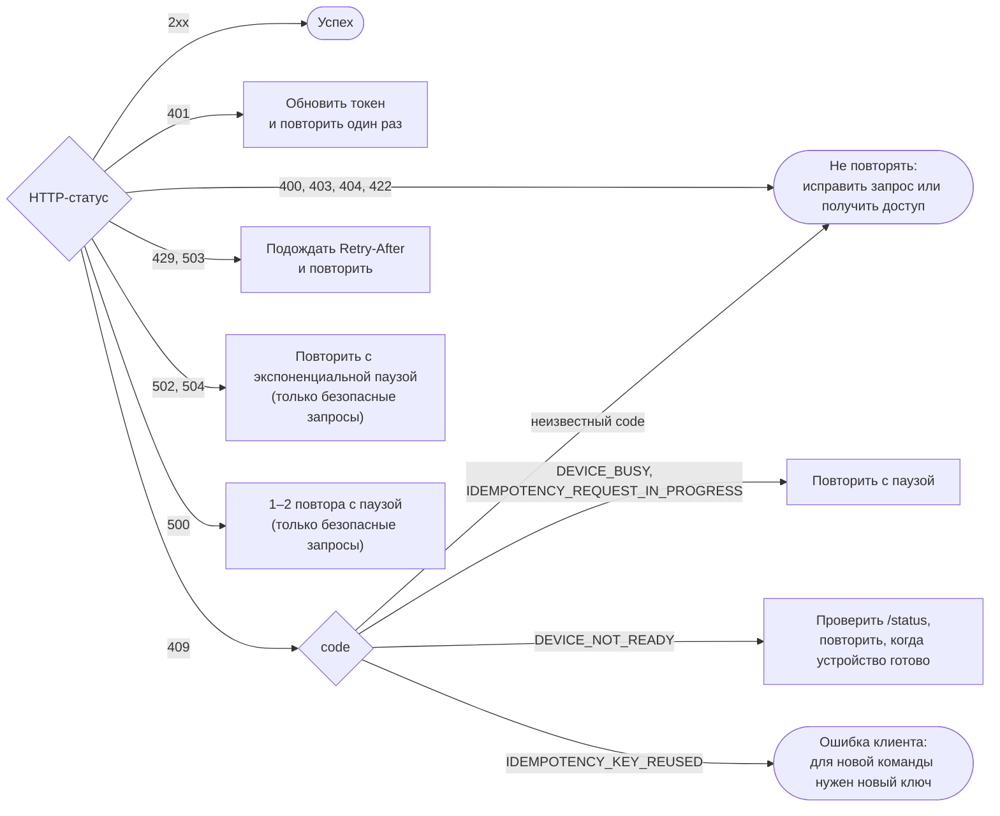

# Диаграммы

[← К оглавлению](../README.md)

Диаграммы построены по контракту [`openapi.yaml`](../openapi.yaml) (версия 2.1.0). Они написаны
на [Mermaid](https://mermaid.js.org) и отображаются в GitHub, GitLab и VS Code; те же диаграммы
в виде картинок лежат в папке [`diagrams/`](diagrams/).

| # | Диаграмма | Тип | Для кого |
|---|---|---|---|
| 1 | [Контекст системы](#1-контекст-системы) | Схема компонентов | Все |
| 2 | [Модель ресурсов](#2-модель-ресурсов) | Диаграмма классов | Разработчики, аналитики |
| 3 | [Жизненный цикл команды](#3-жизненный-цикл-команды) | Диаграмма состояний | Разработчики клиента |
| 4 | [Замена конфигурации](#4-замена-конфигурации) | Последовательность | Разработчики клиента, тестировщики |
| 5 | [Отправка команды и опрос статуса](#5-отправка-команды-и-опрос-статуса) | Последовательность | Разработчики клиента |
| 6 | [Обработка Idempotency-Key](#6-обработка-idempotency-key) | Блок-схема | Разработчики сервера и клиента |
| 7 | [Чтение телеметрии по страницам](#7-чтение-телеметрии-по-страницам) | Блок-схема | Разработчики клиента |
| 8 | [Как клиенту реагировать на ответ](#8-как-клиенту-реагировать-на-ответ) | Дерево решений | Разработчики клиента |

---

## 1. Контекст системы

Кто с кем взаимодействует. Схема **логическая** и выведена из контракта: ответы `502` и `504`
говорят о промежуточном интеграционном слое между API и устройством, а `GET /configuration`
читает данные платформы, не обращаясь к устройству. Реальное устройство развёртывания может
отличаться.

---

## 2. Модель ресурсов

Ресурсы API, их поля и связи. Все ресурсы вложены в устройство (`/v1/devices/{deviceId}/...`).
`?` — необязательное поле.

Перечисления в ответах **открытые**: могут появиться новые значения
(см. [Версии и совместимость](guides/versioning.md)).

---

## 3. Жизненный цикл команды

Отклонённый запрос (`4xx`) ресурс команды не создаёт. Принятая команда (`202`) проходит
`ACCEPTED → IN_PROGRESS` и завершается `SUCCEEDED` или `FAILED`.

---

## 4. Замена конфигурации

`PUT` синхронный: `200` приходит только после того, как устройство применило конфигурацию.
Если подтверждения нет, в силе остаётся прежняя конфигурация.

---

## 5. Отправка команды и опрос статуса

API принимает команду и сразу отвечает `202`; результат клиент узнаёт опросом ресурса
из заголовка `Location`. Интервалы опроса — рекомендация, контракт их не задаёт.

---

## 6. Обработка Idempotency-Key

Как сервер решает, что ответить на `POST /commands` с ключом. Ключ действует в пределах
владельца токена, устройства и эндпоинта и хранится 24 часа.

Тело сравнивается по значениям JSON: порядок полей и пробелы не важны.

---

## 7. Чтение телеметрии по страницам

Курсор привязан к `from` и `to`: между страницами их менять нельзя, `limit` — можно.

---

## 8. Как клиенту реагировать на ответ

Сводка правил из руководств [Ошибки](guides/errors.md) и
[Лимиты и повторные попытки](guides/rate-limits-and-retries.md). Повторы после `5xx`
и таймаутов допустимы только для безопасных запросов: `GET`, `PUT /configuration`
и `POST /commands` с `Idempotency-Key`.

