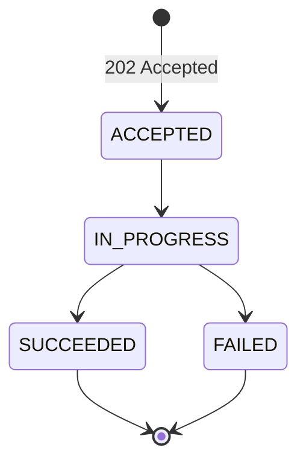

# Команды и идемпотентность

[← К оглавлению](../../README.md)

## Как устроены команды

Устройство выполняет команды (`START`, `STOP`, `RESET`) не мгновенно, поэтому API работает
асинхронно:

1. `POST /v1/devices/{deviceId}/commands` — API проверяет запрос и сразу отвечает
   **`202 Accepted`**. Это означает «принято», а не «выполнено».
2. Заголовок `Location` в ответе указывает на ресурс команды:
   `/v1/devices/{deviceId}/commands/{commandId}`.
3. `GET` по этому адресу показывает ход выполнения. Опрашивайте, пока статус не станет итоговым.



| `status` | Итоговый? | Что есть в ответе |
|---|---|---|
| `ACCEPTED` | нет | — |
| `IN_PROGRESS` | нет | — |
| `SUCCEEDED` | да | `completedAt` |
| `FAILED` | да | `completedAt` и `failure` (`code`, `message`) |

### Отклонение и неудача — не одно и то же

- **Отклонённый запрос** завершается ответом `4xx` (например, `409 DEVICE_NOT_READY` или
  `422 VALIDATION_ERROR`). Команда **не создаётся**, `commandId` нет.
- **Неудачная команда** была принята (`202`), но выполнить её не удалось: у неё статус `FAILED`
  и объект `failure` с причиной. Статуса `REJECTED` не существует.

## Опрос статуса

Контракт не задаёт интервал опроса. Разумная стратегия на стороне клиента:

- первая проверка через ~1 секунду, затем увеличивайте паузу (например, 1 → 2 → 4 с, не больше
  10–15 с);
- ограничьте общее время ожидания (таймаут операции в вашем приложении);
- при `429` ждите столько, сколько указано в `Retry-After`;
- неизвестный статус считайте промежуточным и продолжайте опрос
  (см. [Версии и совместимость](versioning.md)).

```javascript
async function waitForCommand(locationPath, { timeoutMs = 60000 } = {}) {
  const deadline = Date.now() + timeoutMs;
  let delay = 1000;
  while (Date.now() < deadline) {
    await sleep(delay);
    const cmd = await call(BASE_URL + locationPath, { headers: authHeaders });
    if (cmd.status === "SUCCEEDED" || cmd.status === "FAILED") return cmd;
    delay = Math.min(delay * 2, 10000);
  }
  throw new Error("Команда не завершилась за отведённое время");
}
```

## Идемпотентность: безопасные повторы

Сеть ненадёжна: запрос мог дойти до сервера, а ответ потеряться. Если просто отправить команду
снова, устройство может выполнить её дважды. Чтобы этого не случилось, передавайте заголовок
**`Idempotency-Key`**.

```bash
KEY=$(uuidgen)   # один ключ на одно намерение «выполнить эту команду»

curl -i -X POST "$BASE_URL/v1/devices/sg-001/commands" \
  -H "Authorization: Bearer $TOKEN" \
  -H "Content-Type: application/json" \
  -H "Idempotency-Key: $KEY" \
  -d '{"command": "START", "parameters": {}}'

# Таймаут? Повторяем с ТЕМ ЖЕ ключом и тем же телом:
curl -i -X POST "$BASE_URL/v1/devices/sg-001/commands" \
  -H "Authorization: Bearer $TOKEN" \
  -H "Content-Type: application/json" \
  -H "Idempotency-Key: $KEY" \
  -d '{"command": "START", "parameters": {}}'
```

### Правила ключа

| Правило | Значение |
|---|---|
| Формат | Строка 1–128 символов. Рекомендуется UUID v4 |
| Область действия | Владелец токена + `deviceId` + этот эндпоинт. Тот же ключ для другого устройства — новый запрос |
| Срок хранения | 24 часа с первого использования. Потом ключ можно использовать заново: запрос будет новым |
| Сравнение запросов | Метод, путь и тело. Тело совпадает, если JSON равен по значениям: порядок полей и пробелы не важны |
| Что запоминается | Только принятая команда (`202`). После `4xx` или `5xx` ключ не сохраняется |

### Что вернёт повтор

| Ситуация | Ответ |
|---|---|
| Тот же ключ, то же тело, команда была принята | Исходный `202` с тем же `commandId`; вторая команда не создаётся |
| Тот же ключ, **другое** тело | `409 IDEMPOTENCY_KEY_REUSED` |
| Тот же ключ, исходный запрос ещё обрабатывается | `409 IDEMPOTENCY_REQUEST_IN_PROGRESS` — подождите и повторите с тем же ключом |
| Исходный запрос был отклонён (`4xx`) или упал (`5xx`) | Обрабатывается как новый запрос |
| Прошло больше 24 часов | Обрабатывается как новый запрос |

### Рекомендации

- **Всегда передавайте ключ** для `POST /commands`. Без него повтор после таймаута или `502`/`504`
  может создать вторую команду.
- Генерируйте ключ **один раз на действие пользователя** и храните его, пока не получите
  итоговый ответ. Новый ключ на каждую попытку лишает защиты смысла.
- Получили `IDEMPOTENCY_KEY_REUSED` — это ошибка в клиенте: один ключ использован для разных
  команд. Для новой команды нужен новый ключ.

## Конфигурация — повторы без ключа

`PUT /configuration` идемпотентен сам по себе: он заменяет конфигурацию целиком, и повтор с тем же
телом даёт тот же результат. Ключ не нужен. Ответ `200` приходит только после применения
конфигурации устройством; при `502`/`504` в силе остаётся прежняя конфигурация, и запрос можно
безопасно повторить.
